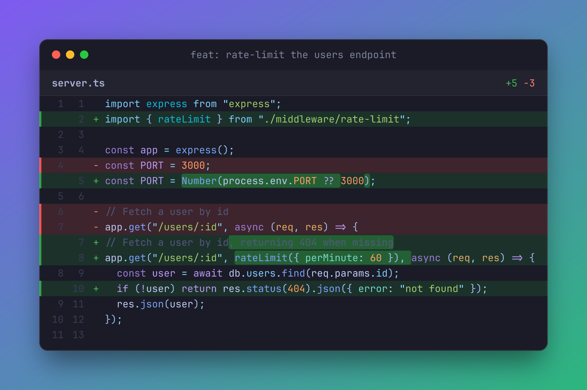
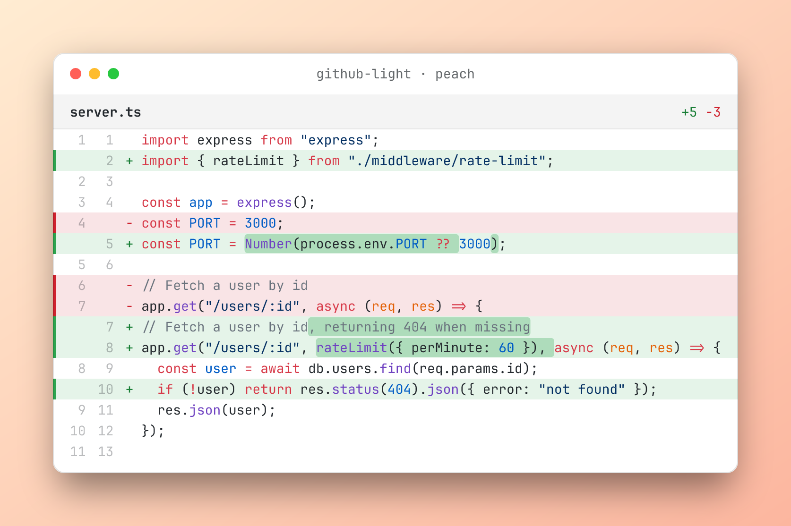
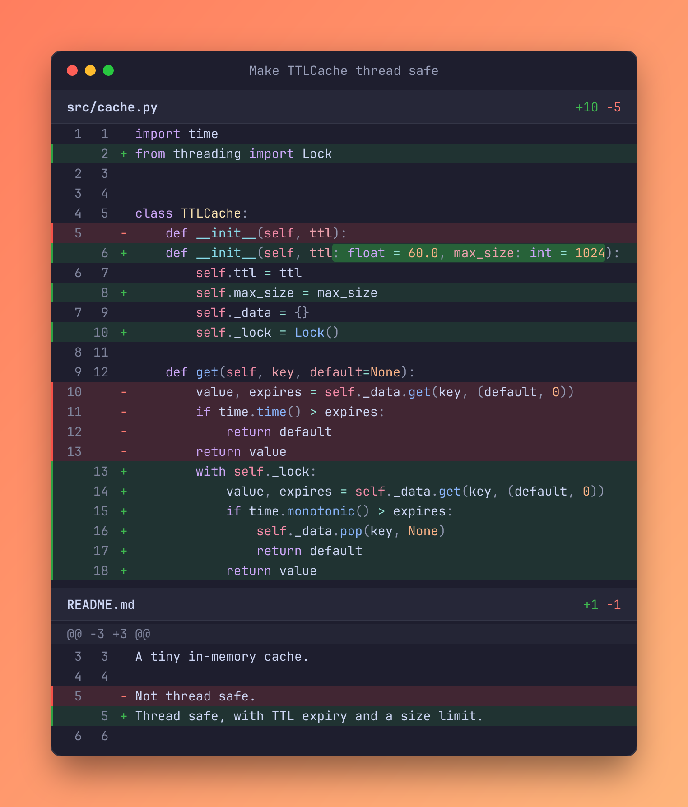
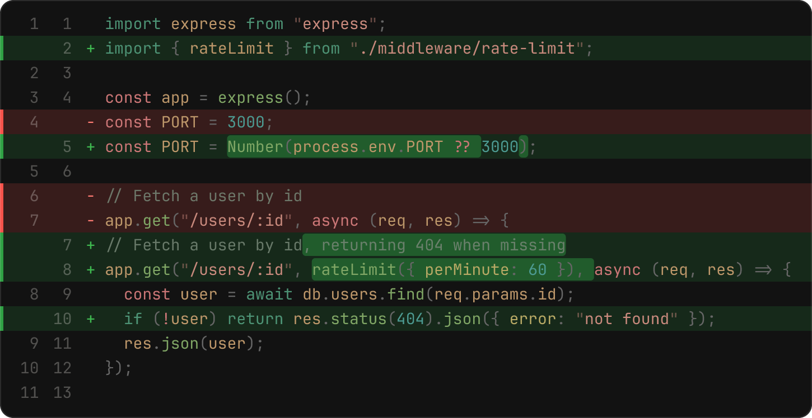

<div align="center">

# diffshot 📸

**Turn git diffs into beautiful, shareable images.**

Like a code screenshot tool, but built for *changes*: syntax highlighting, word-level edits, line numbers and file stats, straight from your terminal.



</div>

## Why

Code screenshot tools are great for showing code. But when you're writing a PR description, a changelog, a blog post or a tweet about a fix, the interesting part is **what changed**. `diffshot` takes any `git diff` and renders it as a polished image in one command. No browser, no copy-pasting.

- 🎨 **Real syntax highlighting.** Powered by [Shiki](https://shiki.style), with every VS Code theme and 200+ languages.
- 🔍 **Word-level diffs.** It highlights exactly *which part* of a line changed, not just the line.
- 🧠 **Highlighting that keeps context.** The old and new sides are highlighted as whole files, so multi-line strings and comments stay correctly colored.
- 🖼️ **PNG or SVG.** Crisp 2× PNGs by default. SVGs embed their font so they look identical everywhere.
- 🔤 **The same image on every machine.** It bundles [JetBrains Mono](https://www.jetbrains.com/lp/mono/) and doesn't depend on installed fonts.
- 📋 **`--copy`** puts the image straight on your clipboard (macOS, Wayland, X11, Windows).
- ⚡ **No browser.** Rendering uses [resvg](https://github.com/RazrFalcon/resvg), so it's fast and works in CI.

## Install

Requires Node.js 20+.

```sh
npm install -g github:Fahnoee/diffshot
# or run it once without installing
npx github:Fahnoee/diffshot --help
```

## Usage

```sh
diffshot                              # uncommitted changes -> diffshot.png
diffshot -c HEAD                      # the last commit (title = commit subject)
diffshot main...my-branch -- src/     # a branch diff, limited to src/
diffshot --staged --copy              # staged changes, copied to the clipboard
git diff | diffshot -o change.svg     # or pipe in any unified diff
diffshot -i fix.patch                 # ...or read a patch file
```

Any arguments you pass that aren't diffshot options go straight to `git diff`, so revision ranges, `--` pathspecs and so on all work.

## Make it yours

```sh
diffshot -t github-light -b peach
diffshot -t catppuccin-mocha -b sunset --title "Make TTLCache thread safe"
diffshot -b none -p 0 --no-chrome --no-file-headers   # just the diff
diffshot -b "#0f0c29,#302b63,#24243e"                 # custom gradient
```

| `-t github-light -b peach` | `-t catppuccin-mocha -b sunset` |
| :---: | :---: |
|  |  |

<details>
<summary><b>Minimal mode</b>: <code>-b none -p 0 --no-chrome --no-file-headers</code></summary>



</details>

Run `diffshot --list-themes` for all syntax themes (`tokyo-night`, `github-dark`, `dracula`, `nord`, `one-dark-pro`, `rose-pine`, `vitesse-light` …) and `diffshot --list-backgrounds` for the gradient presets: `aurora`, `sunset`, `ocean`, `candy`, `grape`, `midnight`, `peach`, `mono`.

### All options

```
Input (default: working tree changes, falling back to staged changes)
  -c, --commit <rev>       Render a single commit (title defaults to its subject)
      --staged             Render staged changes
  -i, --input <file>       Read a patch file ("-" for stdin)
  -U, --context <n>        Lines of context around changes (git only, default 3)

Output
  -o, --output <file>      Output path, .png or .svg (default: diffshot.png)
      --stdout             Write the image to stdout instead of a file
      --copy               Also copy the PNG to the clipboard
  -s, --scale <n>          PNG pixel density (default: 2)

Style
  -t, --theme <name>       Syntax theme (default: tokyo-night)
  -b, --background <bg>    Preset, color, "c1,c2[,c3]" gradient, or "none" (default: aurora)
  -p, --padding <px>       Space around the window (default: 56)
      --title <text>       Window title
      --font-size <px>     Font size (default: 14)
      --max-cols <n>       Truncate lines longer than this (default: 100)
      --max-lines <n>      Stop after this many diff lines (default: 300)
      --no-line-numbers    Hide line numbers
      --no-chrome          Hide the window title bar
      --no-word-diff       Don't highlight changed words within lines
      --no-hunk-headers    Hide @@ hunk separators
      --no-file-headers    Hide per-file headers
      --no-embed-font      Don't embed the font in SVG output (smaller files)
```

## Git alias

```sh
git config --global alias.shot '!diffshot'
git shot -c HEAD --copy
```

## Use it as a library

```js
import { parseDiff, renderSvg, svgToPng } from 'diffshot';

const files = parseDiff(patchText);
const svg = await renderSvg(files, { theme: 'nord', background: 'ocean' });
const png = await svgToPng(svg, { scale: 2 });
```

## Development

```sh
npm install
npm test            # node:test, no extra deps
npm run examples    # regenerate the images in docs/
```

## License

MIT. JetBrains Mono is bundled under the [SIL Open Font License](assets/fonts/OFL.txt).
